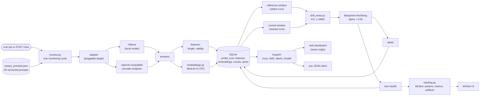

# LLM Drift Monitor

A monitoring tool that watches whether an LLM's answers quietly change over time, and
tells you when they do.

Live demo: [llm-drift-monitor-api.onrender.com](https://llm-drift-monitor-api.onrender.com)
(dashboard at `/`). The hosted demo is self-contained and needs no API keys.

## The problem

Suppose your product answers come from an LLM. Nothing about that LLM is pinned down.
Providers update models, add safety layers, change default settings, or quietly route
you somewhere else, and each of those can change what your users see. The failure is
invisible: no exception fires, the status code stays 200, answers just get longer,
start refusing more often, or drift in topic. You find out from a complaint, possibly
weeks later.

Checking by hand doesn't work either. One answer tells you almost nothing, because
models vary naturally from answer to answer. And reading dozens of answers every
morning doesn't scale.

## System design

Everything is one pipeline: fixed prompts go out, answers come back, statistics decide
whether the answers changed, and every step is recorded.

Notes on the parts that are easy to get wrong:

- Windows are disjoint by construction: the reference window is the oldest stored runs,
  the current window is the newest run of the cycle. Tests never compare a run against
  itself.
- The adapter is pluggable. The same pipeline runs against a local model over Ollama or
  against any hosted OpenAI-compatible endpoint, so the monitor follows whatever the
  product actually calls in production.

## Operational design

The service runs in one small container, so the reliability choices are sized to that
rather than borrowed from bigger deployments:

- **Read cache.** Dashboard panels poll `/stats`, `/drift/latest`, `/drift/results`, and
  `/alerts` through a 5 second TTL cache, so repeat polls and concurrent visitors collapse
  into one set of queries per window. A finished cycle invalidates it, so panels never lag
  behind a result.
- **Single flight run queue.** Cycles write to SQLite and share the embedding model, so
  they are serialized through a one worker queue. `POST /runs` accepts an `Idempotency-Key`
  header and replays the original run id for duplicate submissions; a minimum interval
  between submissions acts as a rate limit, returning `429` with `Retry-After`.
- **Circuit breaker.** The target model adapter opens after three consecutive failed calls
  and fails fast for a cooldown window, instead of paying full retries on every probe while
  the endpoint is down. Retries themselves use exponential backoff with jitter on 429, 5xx,
  timeouts, and network errors.
- **Storage.** SQLite runs in WAL mode, so dashboard reads proceed while a cycle writes,
  and every filter and ordering column is indexed.
- **Observability.** `GET /metrics` exposes counters (cycles, failures, queue depth, cache
  hit rate, rejections, peak memory, embedding model residency) in Prometheus text format.
  Every request is logged as one structured JSON line with a correlation id (`X-Request-ID`
  on both request and response), and run cycles log duration and outcome the same way.
- **MLflow without the memory cost.** Each cycle logs its params, metrics, and the full
  drift report to MLflow from a short lived subprocess: the serving process never imports
  mlflow, so a memory capped deployment stays safe while every run still lands in the
  tracking store, pinned to the exact git hash and config.

Deliberately not used: read replicas, data sharding, and a CDN. There is one SQLite file
per deployment, queried through indexed paths; sharding or replicas would add moving parts
without a load problem to solve. Static assets are two files served from the same origin,
so a CDN would only add a third place to cache. If the demo outgrows the free tier, the
seams that matter are already in place: the tracking URI is configurable (a hosted MLflow
backend drops in), the queue is the single place runs are admitted, and reads already go
through one cache layer.

## How MLflow is used

`tracking.py` wraps every daily run and every experiment sweep in an MLflow run, so
each check is reproducible and comparable:

| Captured | Examples |
|---|---|
| Params | target model, prompt set version, embedding model, alpha, window sizes, kernel bandwidth, git hash, seed |
| Metrics | KS / z / MMD statistics, raw p values, BH-adjusted p values, number of flagged tests, token counts |
| Artifacts | the full drift report as JSON |

That makes two things possible. First, provenance: every alert on the dashboard
corresponds to an MLflow run pinned to an exact commit and config. Second, iteration:
detector configurations (embedding model, bandwidth heuristic, window sizes) are logged
as separate runs, so the MLflow UI can compare them directly instead of trusting a
notebook.

Daily runs land in the `llm-drift-daily` experiment; experiment sweeps land in
`llm-drift-experiments`. The backend is a local SQLite file, so the whole setup runs
with no server and no credentials.

## How this project handles it

The monitor runs the same 40 test prompts against the target model on a schedule and
stores every answer in SQLite. Each check then compares a batch of recent answers with
a saved baseline, using three small statistical tests:

1. **Answer length**: a KS test asks whether recent answers are noticeably longer or
   shorter than the baseline ones.
2. **Useful answers**: a two-proportion test on how often answers come back empty.
   A jump here usually means the model started refusing or breaking.
3. **What answers mean**: answers are turned into text embeddings, and an MMD test
   (kernel based, permutation p value) asks whether the overall meaning mix changed,
   which catches topic or tone drift that length and counts miss.

Three tests at once should not make three chances to cry wolf, so raw p values go
through Benjamini-Hochberg correction at alpha = 0.05 before anything is flagged.
When tests fire, the monitor writes an alert. Nothing is auto-panic: a flag means
"look at the answers", and a person decides.

## Does it actually work

Evaluated on synthetic data where the truth is known, using `experiments/`:

- False alarm rate under the null (200 simulations): KS 0.02, z 0.005 of raw p values,
  MMD and BH-corrected versions 0.015 or lower. In words: when nothing changed, the
  tests almost never cried wolf.
- A mismatch of 20 per cent on a MMD bandwidth was caught, then fixed with the median
  heuristic, so calibration held after the fix.
- On a 90 day simulation with a change injected at day 45: no alerts during the 100
  quiet days, and the drift was caught about 18 days after the change started.
- Power measurements across shift sizes and window sizes say how many probes a day
  you need for a given change, so the prompt count isn't a guess.
- Only a one category shifted test pointed at the right category (precision and recall
  of 1.0 in that experiment), so localization is feasible, not perfect.

Conclusions and CSV/PNG outputs for all of this are in `results/`, and every script
takes a `--seed`, so the numbers above can be regenerated.

## Try it

- Live demo: open the URL above and press "Run a check now". Ten answers get stored
  and the panels refresh. At least 60 saved answers are needed for the tests to run,
  and the demo history already contains a batch where the answers deliberately changed,
  so the alert panel has real entries on a fresh visit.
- Local, no keys needed: `python -m scripts.generate_seed_db`, then
  `uvicorn api:app --port 8000` and open `http://localhost:8000`.
- With your own local model (Ollama): point `config/config.yaml` at `target.type: local`
  and run `python -m main --run` as a daily cron job.

The service is also a plain JSON API: `GET /health`, `GET /drift/latest`,
`GET /drift/results`, `GET /alerts`, `GET /runs`, `GET /stats`, `POST /runs`. The
dashboard is a thin page over it.

## Repo layout

- `monitor.py`: the pipeline: pluggable adapters, probe runs, window comparisons,
  alerts. Retries with backoff on 429, 5xx, timeouts.
- `drift_tests.py`: the three tests plus BH correction and the RBF kernel.
- `storage.py`: SQLite schema and queries.
- `embeddings.py`: MiniLM embeddings for the MMD test.
- `tracking.py`: MLflow logging (see the section above).
- `api.py`: FastAPI service; `web/` is the dashboard page it serves.
- `config/`: runtime configs and the canary prompt set.
- `scripts/generate_seed_db.py`: builds the demo history with a baked-in shift.
- `experiments/`: the evaluation described above.

## Testing

`pytest` (24 tests) and `ruff check .` run in CI on every push. The tests cover the BH
correction against a hand-checked example, the reference window logic, alert storage,
and the retry behaviour of the network adapters with a mocked transport.

## Honest limitations

- A flag is a hint, not proof of bad quality: no labeled ground truth exists here, so
  a change can also be benign (an update made answers friendlier).
- 40 prompts across 5 categories is a small lens: a shift in an untested behavior
  would not be seen.
- The numbers in "Does it actually work" come from simulations; real traffic windows
  are noisier than the synthetic ones.
- The free hosting tier has a small memory budget and a database that resets on
  redeploys; locally, persistence and MLflow logging are unrestricted.
